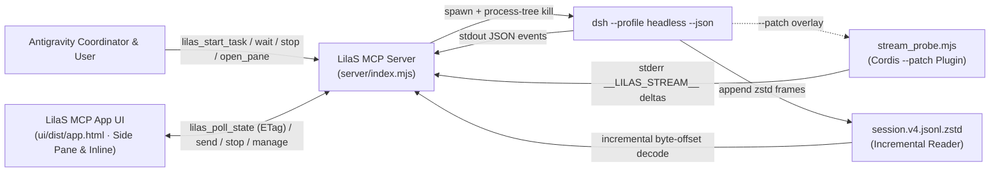

<p align="center">
  
</p>

<p align="center">
  <b>English</b> | <a href="README.zh-CN.md">简体中文</a>
</p>

<p align="center">
  
  
  
  
  
</p>

---

**LilaS** is a native **Antigravity MCP App plugin** that bridges your local **DeepSeek Harness (DSH)** into Antigravity as a dedicated, project-isolated **Mode A execution subagent** — complete with **token-level typewriter reasoning streams**, **merged tool-call cards**, **1M context & prompt-cache telemetry**, **idle stall watchdogs**, and **one-click file previews** directly inside Antigravity's side pane and chat stream.

> **Coordinator + Executor workflow**: Keep Antigravity as your high-level architect, reviewer, and orchestrator while delegating heavy coding, batch scripts, data audits, and test loops to LilaS — without ever switching windows or touching your DSH Desktop sessions.

---

## Highlights

- **True Typewriter-Grade Streaming (Zero DSH Core Modification)**
  Instead of waiting for each step to flush to disk, LilaS mounts a ~40-line local Cordis probe (`server/stream_probe.mjs`) via DSH's official `--patch` overlay to subscribe to `agent/assistant-stream` and stream live `reasoning-delta`, `text-delta`, `tool-call-delta`, and `usage` tokens directly to the UI — with automatic disk-commit deduplication for zero flicker.
- **Merged Tool Cards + Click-to-Open Files**
  Pairs DSH v4 `tool/call` and `tool/result` events by `toolCallId` into a single collapsible card displaying execution status (`✓` / `✕` / `…`), smart parameter summaries, exact millisecond/second durations, and clickable file pills powered by Antigravity's `com.google.antigravity/toggle-aux-pane` extension.
- **Live 1M Context Window & Prompt Cache Meter**
  Extracts per-step `totalTokens` and `cacheReadTokens` directly from session events and renders a compact progress bar in the header strip (amber at 70%, red at 85%) so you always know how close a long session is to auto-compaction.
- **Strict Project Isolation + Dual Surface (Inline Card & Side Pane)**
  Scopes sessions and active parallel agent chips to each workspace's `cwd` automatically (with an opt-in **All Projects** toggle). Dispatching a task renders a compact project-scoped inline status card in the conversation while syncing the full timeline in the right-hand **LilaS** side pane.
- **No Premature Timeouts — Idle Watchdog & Self-Healing**
  Default wall-clock timeout is **`0` (unlimited)** so productive 20-minute builds are never killed mid-work. Instead, a 180-second **Idle Watchdog** detects genuine hangs (`lastActivityAt` across stdout, live deltas, and `.zstd` growth), wakes the coordinator early, and pairs with `lilas_stop_task` (full Windows process-tree `taskkill /T /F`) and upstream refusal-truncation detection for automatic recovery.
- **High-Performance Incremental Zstd Decoder + ETag Polling**
  Uses Node 22's built-in `zlib.zstdDecompressSync` with a tolerant frame-boundary scanner (`decodeZstdFramesTolerant`) and byte-offset incremental decoding — reading only newly appended frames of active `session.v4.jsonl.zstd` logs, paired with ETag short-circuiting on `lilas_poll_state`.
- **Clean, Self-Contained Minimalist UI**
  Zero external network requests (strict default MCP App CSP), zero-dependency XSS-safe Markdown renderer with code-block copy buttons, sandbox-safe clipboard fallback, inline session renaming/pinning/hiding (never modifies `.zstd` logs), incremental DOM reconciliation (preserves text selection), and native Antigravity light/dark theme variables.
- **Zero-Conflict & Credential-Safe by Design**
  Strictly runs official **Mode A** (`dsh --profile headless`), blocks accidental resumption of DSH Desktop `standard` preset sessions preflight, auto-inherits recorded `cwd` on resume, and relies exclusively on DSH's own credential store — never reading, storing, or printing API keys.

---

## Architecture



---

## Prerequisites

- **Antigravity** (with MCP Apps & global plugins enabled)
- **Node.js `>= 22.15`** (required for built-in `zlib.zstdDecompressSync`)
- **DeepSeek Harness (`dsh`)** installed locally and runnable via `dsh` in `PATH` (or pointed to via `LILAS_DSH_BIN`)

---

## Quick Start

### Option 1: One-Command Install

**Windows (PowerShell):**
```powershell
git clone https://github.com/AsahiYi/LilaS.git
cd LilaS
powershell -ExecutionPolicy Bypass -File .\scripts\install.ps1
```

**macOS / Linux:**
```bash
git clone https://github.com/AsahiYi/LilaS.git
cd LilaS
bash ./scripts/install.sh
```

The installer copies LilaS into `~/.gemini/config/plugins/lilas/`, installs server dependencies, and builds the self-contained single-file `ui/dist/app.html`.

### Option 2: Configure Provider / Model Overlay (Optional)

If you use a custom OpenAI-compatible provider or want to align headless mode with your Desktop model & compaction settings:

```bash
cp ~/.gemini/config/plugins/lilas/config/mode_a_patch.example.yml \
   ~/.gemini/config/plugins/lilas/config/mode_a_patch.yml
```

Edit `config/mode_a_patch.yml` (git-ignored) to set your provider, model, `contextWindow`, `maxTokens`, and `reasoningEffort`.

If `dsh` is not in your system `PATH` (for example, bundled inside DSH Desktop), add `LILAS_DSH_BIN` to `~/.gemini/config/plugins/lilas/mcp_config.json`:

```json
{
  "mcpServers": {
    "lilas": {
      "command": "node",
      "args": ["${PLUGIN_ROOT}/server/index.mjs"],
      "env": {
        "LILAS_PLUGIN_ROOT": "${PLUGIN_ROOT}",
        "LILAS_DATA_DIR": "${PLUGIN_DATA}",
        "LILAS_DSH_BIN": "/path/to/dsh/node_modules/@deepseek-ai/dsh/lib/bin.js"
      }
    }
  }
}
```

Then open **LilaS** from Antigravity's side pane **`+`** menu or left sidebar — or simply ask Antigravity to delegate a task to **LilaS**!

---

## MCP Tools Reference

### Model-Visible Tools
| Tool | Purpose |
| :--- | :--- |
| `lilas_open_pane` | Opens or focuses the **LilaS** side pane (`aux_pane` & `global` entrypoint), automatically scoping to `cwd` or `session_id` |
| `lilas_start_task` | Launches a Mode A DSH subagent asynchronously, renders a project-isolated inline card, waits up to 10s for `session_id`, and arms the Idle Watchdog (`timeout_sec=0` by default) |
| `lilas_wait_task` | Heartbeat wait (default `90s`, or instant `status_only: true`) returning progress, `idleSec`, `[STALLED]` alerts, upstream refusal alerts, reasoning excerpts, and up to 32K chars of final output |
| `lilas_stop_task` | Terminates a running or stalled subagent and its entire child process tree, releasing the per-session concurrency lock |
| `lilas_list_sessions` | Lists Mode A sessions scoped by optional `cwd`, with user aliases, pin status, and live running indicators |

### App-Only Tools (`visibility: ["app"]`)
| Tool | Purpose |
| :--- | :--- |
| `lilas_poll_state` | High-frequency UI state sync with ETag short-circuiting, project scoping, live typewriter deltas, and incremental timeline data |
| `lilas_ui_send_task` | Dispatches tasks directly from the panel composer (with memorized `cwd` picker for new sessions) |
| `lilas_ui_stop_task` | Stops the active task & child process tree from the header button |
| `lilas_ui_manage_session` | Renames, pins, or hides sessions in local metadata (`plugin_sessions.json`) without modifying disk `.zstd` logs |

---

## Environment Variables

| Variable | Default | Description |
| :--- | :--- | :--- |
| `LILAS_DSH_BIN` | `dsh` / `dsh.cmd` | Path to `dsh` executable or `@deepseek-ai/dsh/lib/bin.js` |
| `LILAS_PATCH_FILE` | `config/mode_a_patch.yml` (if present) | Optional YAML patch overlay passed to `dsh --patch` |
| `LILAS_DSH_SESSIONS_DIR` | `~/.dsh/sessions` | Override DSH session storage directory |
| `LILAS_DEFAULT_CWD` | `process.cwd()` | Fallback working directory when `cwd` is omitted |
| `LILAS_PLUGIN_ROOT` | Plugin directory | Provided automatically via `${PLUGIN_ROOT}` |
| `LILAS_DATA_DIR` | `${PLUGIN_DATA}` | Persistent metadata & auto-generated stream probe patch directory |

---

## Project Structure

```text
LilaS/
├── plugin.json                    # Antigravity plugin manifest
├── mcp_config.json                # MCP server configuration
├── assets/
│   ├── logo.svg                   # Plugin icon
│   └── banner.svg                 # Repository hero banner
├── config/
│   └── mode_a_patch.example.yml   # Headless model & credential patch template
├── rules/
│   └── AGENTS.md                  # Global Coordinator + LilaS workflow rule
├── skills/
│   └── lilas/SKILL.md             # On-demand subagent delegation skill
├── scripts/
│   ├── install.ps1                # Windows installer
│   └── install.sh                 # macOS / Linux installer
├── server/
│   ├── index.mjs                  # MCP server, process-tree manager, watchdog, ETag snapshotter
│   ├── dsh_reader.mjs             # Incremental zstd frame decoder, tool merger, usage extractor
│   └── stream_probe.mjs           # Zero-invasive Cordis plugin for live token streaming
└── ui/
    ├── build.mjs                  # esbuild single-file HTML bundler + light/dark CSS
    └── src/
        ├── app.js                 # Incremental DOM panel, chips, inline rename, file preview
        └── markdown.js            # Zero-dependency XSS-safe Markdown renderer
```

---

## License

[MIT](LICENSE) © 2026 AsahiYi
