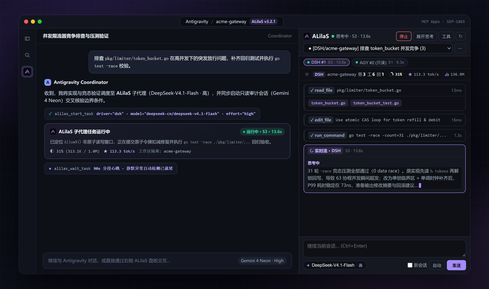
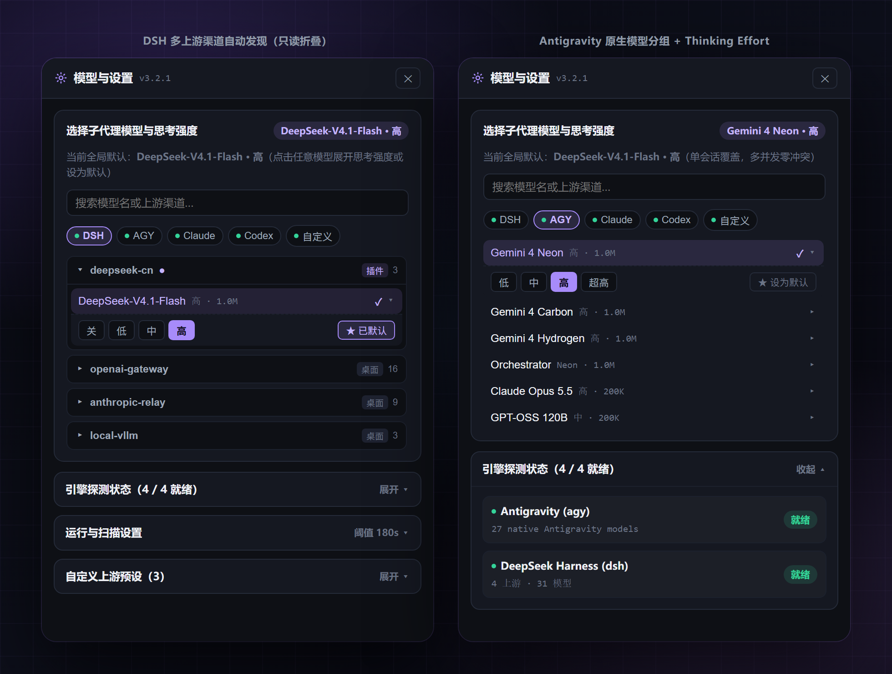
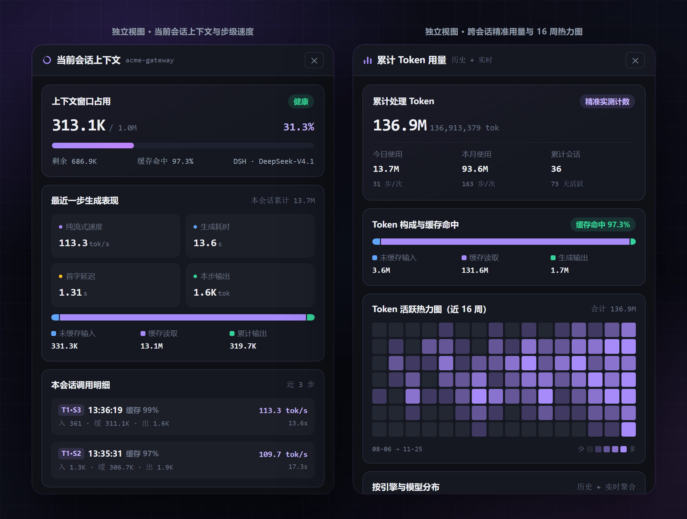
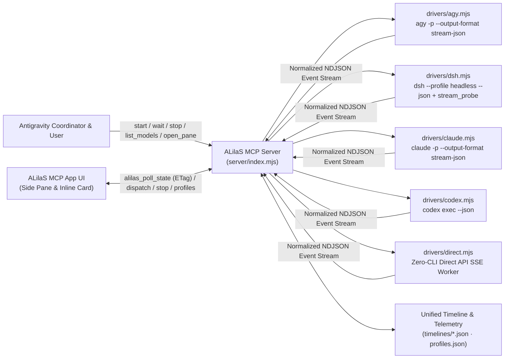

<p align="center">
  
</p>

<p align="center">
  <b>English</b> | <a href="README.zh-CN.md">简体中文</a>
</p>

<p align="center">
  
  
  
  
  
  
</p>

---

**ALilaS** (**A**ntigravity + **LilaS**) is a native multi-engine **subagent orchestration studio** (`better-subagent`) for **Antigravity**, built on the **MCP Apps (SEP-1865)** specification.

It unifies **Antigravity Native (`agy`)**, **DeepSeek Harness (`dsh`)**, **Claude Code (`claude`)**, **OpenAI Codex CLI (`codex`)**, and a built-in zero-injection **Direct API (`direct`)** engine behind a workspace-isolated side pane and inline chat card — featuring **process-isolated concurrent model routing**, **token-level streaming reasoning visualization**, **structured tool execution traces**, **exact native telemetry**, and **automated stall detection & recovery**.

<p align="center">
  
</p>

---

## Key Capabilities

### 1. Unified Multi-Engine Orchestration (`AGY` · `DSH` · `Claude` · `Codex` · `Direct API`)
- **Antigravity Native (`agy`)**: Auto-discovers all native Antigravity models via `agy models` (Gemini 4 Neon / Carbon / Argon / Hydrogen, Orchestrator, Claude Opus / Sonnet 5.5, GPT-OSS 120B), deduplicating variants by base model with inline **Thinking Effort** controls — zero extra API keys required.
- **DeepSeek Harness (`dsh`)**: Mode A headless execution paired with a non-invasive local Cordis streaming probe (`stream_probe.mjs`) and read-only YAML discovery from `~/.dsh/profiles/desktop/cordis.patch.yml` (preserving exact `contextWindow`, `input` vision flags, `reasoningEfforts` mappings, and official `sandbox-policy: read-only`).
- **Claude Code (`claude`) & Codex CLI (`codex`)**: Native `stream-json` and `exec --json` protocol adapters with automatic CLI & active model discovery from `~/.claude/settings.json` and `~/.codex/config.toml` (fully compatible with **CCSwitch** relays).
- **Direct API (`direct`, zero external CLI / zero third-party injection)**: Built-in zero-dependency Node 22 SSE headless worker supporting **OpenAI Chat Completions**, **OpenAI Responses**, and **Anthropic Messages** with a minimal workspace tool loop (`read_file`, `list_dir`, `grep_search`, `run_command`, `edit_file`, `write_file`, and optional `read_image` gated by the model's vision checkbox).

### 2. Process-Isolated Concurrent Model Routing
- Pin any native model, discovered DSH upstream, or custom preset as your global default inside **Model & Settings**, while overriding engine, model, and reasoning effort per session with zero cross-session interference.
- `agy`, `claude`, and `codex` isolate configuration via per-process CLI flags; `dsh` synthesizes ephemeral per-run `--patch` overlays cleaned up automatically on exit — shared config files are never mutated.
- **Zero-Plaintext Credential Policy**: Custom upstream presets store environment variable references only; raw API keys are never persisted or echoed.

<p align="center">
  
</p>

### 3. Strictly Isolated Native Telemetry Views
A minimalist telemetry strip (`⚙  ◐ 31%  ★ 113.3 tok/s  ılı 136.9M`) separates **Session Context**, **Lifetime Usage**, and **Model & Settings** into three standalone, focused views:
- **Current Session Context**: Context-window budget meter (color-coded at 70% / 85%), pure streaming throughput (`tok/s`), step duration, time-to-first-token (TTFT), prompt-cache hit rate, and per-step execution history across both live and historical sessions.
- **Lifetime Token Usage**: Exact native usage aggregation across historical and active sessions with zero guessed price estimates — featuring uncached input / cache read / output composition bars, a responsive 16-week activity heatmap, and ranked engine/model breakdowns.

<p align="center">
  
</p>

### 4. Structured Tool Traces & Unbounded Long-Task Reliability
- **Paired Tool Cards & Direct File Preview**: Correlates tool invocations and results by `toolCallId` into collapsible cards with exact latency (`ms` / `s`), error highlighting, and clickable file pills via Antigravity's native `toggle-aux-pane`.
- **Auto & Read-Only Permission Modes**: Switch between full autonomous execution and read-only audit/plan sandboxes (`agy --mode plan`, `claude --permission-mode plan`, `codex --sandbox read-only`) in one click.
- **Unbounded Execution & Automated Stall Detection**: Wall-clock timeout defaults to **`0` (unlimited)** so long builds and test suites are never prematurely aborted. A configurable idle-activity detector (default `180s`) pairs with `90s` heartbeat polling (`alilas_wait_task`), full process-tree termination (`alilas_stop_task` via `taskkill /T /F` on Windows), and upstream refusal alerts.
- **Workspace Isolation & Self-Contained UI**: Sessions and concurrent subagent chips are automatically scoped to each workspace's `cwd`. Built as a zero-external-request single-file HTML bundle (`ui/dist/app.html`) complying with strict MCP App CSP and Antigravity's native light/dark theme tokens.

---

## Architecture



---

## Quick Start

### Prerequisites
- **Antigravity** (with MCP Apps & global plugins enabled)
- **Node.js `>= 22.15`** (for built-in `zlib.zstdDecompressSync`)
- At least one supported CLI installed: `agy`, `dsh`, `claude`, or `codex`

### One-Command Install

**Windows (PowerShell):**
```powershell
git clone https://github.com/AsahiYi/ALilaS.git
cd ALilaS
powershell -ExecutionPolicy Bypass -File .\scripts\install.ps1
```

**macOS / Linux:**
```bash
git clone https://github.com/AsahiYi/ALilaS.git
cd ALilaS
bash ./scripts/install.sh
```

> The installer deploys ALilaS to `~/.gemini/config/plugins/alilas/`, installs server dependencies, and compiles `ui/dist/app.html`. Existing local `config/mode_a_patch.yml` and custom `mcp_config.json` environment overrides are preserved automatically on upgrades.

### Custom Upstreams & Relay Configuration
- **In-UI Settings**: Click **`⚙`** (or the bottom model capsule) to open **Model & Settings**, then expand **Custom Upstream Presets** to register any OpenAI-compatible or Anthropic relay model (stores **env variable names only**, never raw API keys).
- **CCSwitch Users**: Codex and Claude drivers automatically inherit your active `~/.codex/config.toml`, `~/.claude/settings.json`, `OPENAI_BASE_URL`, and `ANTHROPIC_BASE_URL`.
- **DSH Base Overlay**: Copy `config/mode_a_patch.example.yml` to `config/mode_a_patch.yml` (git-ignored).

---

## MCP Tools Reference

| Tool | Visibility | Description |
| :--- | :--- | :--- |
| `alilas_open_pane` | Model + App (`aux_pane` + `global`) | Opens/focuses the **ALilaS** side pane scoped to `cwd` / `session_id` |
| `alilas_start_task` | Model + App (inline card) | Launches any engine (`agy` / `dsh` / `claude` / `codex`) with per-run model, effort & mode overrides |
| `alilas_wait_task` | Model | `90s` heartbeat polling (or `status_only: true`) with `[STALLED]` alerts, TPS/context telemetry & 32K final output |
| `alilas_stop_task` | Model | Full process-tree termination (`taskkill /T /F` on Windows), freeing concurrency locks immediately |
| `alilas_list_models` | Model | Lists detected engines, native & discovered DSH upstreams, custom presets, and global defaults |
| `alilas_list_sessions` | Model | Lists cross-engine subagent sessions with optional `cwd` filtering |
| `alilas_poll_state` | App-only | ETag-optimized UI polling with project isolation, live deltas & aggregated telemetry |
| `alilas_ui_send_task` | App-only | Direct composer dispatch with selected engine, model, effort, permission mode & cwd |
| `alilas_ui_stop_task` | App-only | Header stop button triggering full process-tree termination |
| `alilas_ui_manage_session` | App-only | Inline rename, pin, and hide (never mutates raw disk logs) |
| `alilas_ui_manage_profiles` | App-only | Manage global default model, driver re-detection, runtime settings & custom upstream presets |

---

## Environment Variables

| Variable | Default | Description |
| :--- | :--- | :--- |
| `ALILAS_AGY_BIN` | `agy` on `PATH` | Override Antigravity CLI path |
| `ALILAS_DSH_BIN` | `dsh` on `PATH` | Override DSH CLI or `@deepseek-ai/dsh/lib/bin.js` path |
| `ALILAS_CLAUDE_BIN` | `claude` on `PATH` | Override Claude Code CLI path |
| `ALILAS_CODEX_BIN` | `codex` on `PATH` | Override Codex CLI path |
| `ALILAS_PATCH_FILE` | `config/mode_a_patch.yml` | Optional DSH base YAML patch overlay |
| `ALILAS_DSH_SESSIONS_DIR` | `~/.dsh/sessions` | Override DSH session directory |
| `ALILAS_DEFAULT_CWD` | `process.cwd()` | Fallback working directory |

---

## License

[MIT](LICENSE) © 2026 AsahiYi
