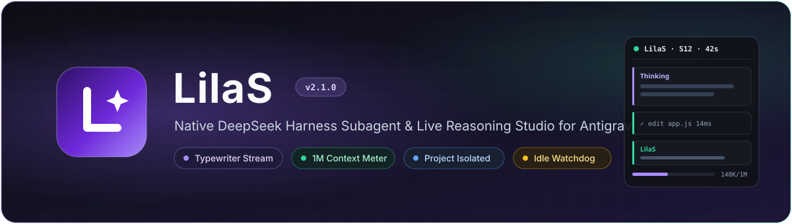
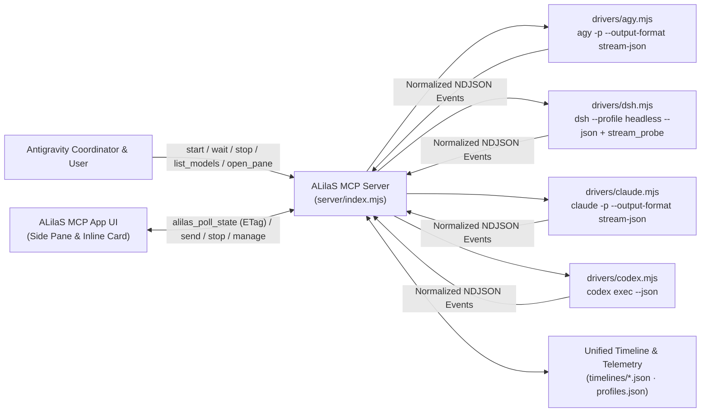

<p align="center">
  
</p>

<p align="center">
  <b>English</b> | <a href="README.zh-CN.md">简体中文</a>
</p>

<p align="center">
  
  
  
  
  
  
</p>

---

**ALilaS** (**A**ntigravity + **LilaS**) is a **better-subagent studio** for **Antigravity** built on the native **MCP Apps (SEP-1865)** specification.

It unifies **four headless CLI agent engines** — **Antigravity Native (`agy`)**, **DeepSeek Harness (`dsh`)**, **Claude Code (`claude`)**, and **OpenAI Codex CLI (`codex`)** — behind one sleek, project-isolated side pane and inline chat card with **per-run conflict-free model switching**, **typewriter-grade live reasoning**, **merged tool cards**, **live ring/TPS/token telemetry**, and **idle stall self-healing**.

---

## Why ALilaS?

- **One Subagent Studio, Four Engines (`AGY` · `DSH` · `Claude` · `Codex`)**
  - **Antigravity Native (`agy`)**: Auto-discovers all native Antigravity models via `agy models` (Gemini 4 Neon/Carbon/Argon/Hydrogen, Gemini 3.8 Flash, Claude Opus/Sonnet 5.5, GPT-OSS 120B) with zero extra API keys.
  - **DeepSeek Harness (`dsh`)**: Runs Mode A headless with a zero-invasive local Cordis streaming probe (`stream_probe.mjs`) and per-run temporary `--patch` overlays for any custom OpenAI-compatible upstream model.
  - **Claude Code (`claude`) & Codex CLI (`codex`)**: Native `stream-json` / `exec --json` adapters with automatic CLI detection and zero-config compatibility with native logins, `~/.codex/config.toml`, and **ccswitch** / custom API relays.
- **Zero-Conflict Per-Run & Per-Session Model Switching**
  Pin any model (native or custom upstream) as your default subagent model, while freely choosing a completely different engine or model in another concurrent session. `agy`/`claude`/`codex` pass per-process flags; `dsh` generates isolated per-run temporary `--patch` overlays cleaned up on exit — shared config files are never mutated.
- **Live Telemetry Strip (`◐ 60%  ★ 115.6 tok/s  ılı 117.0M`)**
  Real-time circular SVG context-window ring (color-coded at 70%/85% with prompt-cache hit-rate tooltip), live & step-calibrated output throughput (`tok/s`), and persistent lifetime/session token counters.
- **Merged Tool Cards + Click-to-Open Files**
  Pairs tool calls with results into one collapsible card with exact durations (`ms`/`s`), error highlighting, smart parameter summaries, and clickable file pills via Antigravity's `com.google.antigravity/toggle-aux-pane`.
- **Auto / Read-Only Permission Modes**
  Switch between **Auto** execution and **Read-Only** audit/plan mode (`agy --mode plan`, `claude --permission-mode plan`, `codex --sandbox read-only`) in one click.
- **Never Kill Active Work — Idle Watchdog & Self-Healing**
  Default wall-clock timeout is **`0` (unlimited)** so 20-minute builds are never murdered mid-run. Instead, a 180s **Idle Watchdog** detects real hangs, pairs with 90s heartbeat polling (`alilas_wait_task`), full Windows process-tree termination (`alilas_stop_task` via `taskkill /T /F`), and upstream refusal-truncation alerts.
- **Strict Project Isolation + Dual Surface**
  Sessions and multi-agent chips are automatically scoped to each workspace's `cwd` (with an **All Projects** toggle in `⋯`). Dispatches render both a compact inline status card in chat and the full timeline in the right-hand **ALilaS** side pane.
- **Minimalist, Zero-External-Request UI**
  Self-contained single-file HTML (`ui/dist/app.html`) complying with strict MCP App CSP, zero-dependency XSS-safe Markdown renderer, sandbox-safe clipboard fallback, inline session renaming/pinning/hiding, incremental DOM updates, and native Antigravity light/dark theme tokens.

---

## Architecture



---

## Quick Start

### Prerequisites
- **Antigravity** (with MCP Apps & global plugins enabled)
- **Node.js `>= 22.15`** (for built-in `zlib.zstdDecompressSync`)
- At least one supported CLI installed: `agy` (Antigravity CLI), `dsh`, `claude`, or `codex`

### One-Command Install

**Windows (PowerShell):**
```powershell
git clone https://github.com/AsahiYi/ALilaS.git
cd ALilaS
powershell -ExecutionPolicy Bypass -File .\scripts\install.ps1
```

**macOS / Linux:**
```bash
git clone https://github.com/AsahiYi/ALilaS.git
cd ALilaS
bash ./scripts/install.sh
```

The installer deploys ALilaS into `~/.gemini/config/plugins/alilas/`, installs server dependencies, builds `ui/dist/app.html`, and runs driver tests.

### Optional: Custom Upstream Models & Relay Configuration
- **In the UI**: Click **`+ 上游`** right above the composer to register any custom OpenAI-compatible or Anthropic relay model (stores **env variable names only**, never raw API keys) and click **`默认`** to set your default subagent model.
- **DSH base overlay**: Copy `config/mode_a_patch.example.yml` to `config/mode_a_patch.yml` (git-ignored).
- **CCSwitch users**: Codex and Claude drivers automatically inherit your active `~/.codex/config.toml`, `~/.claude/settings.json`, `OPENAI_BASE_URL`, and `ANTHROPIC_BASE_URL` with zero extra setup.

---

## MCP Tools Reference

| Tool | Visibility | Description |
| :--- | :--- | :--- |
| `alilas_open_pane` | Model + App (`aux_pane` + `global`) | Opens/focuses **ALilaS** side pane scoped to `cwd` / `session_id` |
| `alilas_start_task` | Model + App (inline card) | Launches any driver (`agy`/`dsh`/`claude`/`codex`) with per-run model/effort/mode overrides |
| `alilas_wait_task` | Model | 90s heartbeat wait (or `status_only: true`) with `[STALLED]` alerts, TPS/context telemetry & 32K final output |
| `alilas_stop_task` | Model | Process-tree termination (`taskkill /T /F` on Windows) freeing concurrency locks |
| `alilas_list_models` | Model | Lists all detected engines, live native models, custom presets, and current default |
| `alilas_list_sessions` | Model | Lists sessions across engines with optional `cwd` filter |
| `alilas_poll_state` | App-only | ETag-optimized UI polling with project isolation, live deltas & telemetry |
| `alilas_ui_send_task` | App-only | Direct composer dispatch with model/driver/mode/cwd selection |
| `alilas_ui_stop_task` | App-only | Header stop button process-tree kill |
| `alilas_ui_manage_session` | App-only | Inline rename, pin, and hide (never touches raw disk logs) |
| `alilas_ui_manage_profiles` | App-only | Set default model, refresh drivers, and add/delete custom upstream presets |

---

## Environment Variables

| Variable | Default | Description |
| :--- | :--- | :--- |
| `ALILAS_AGY_BIN` | `agy` on `PATH` | Override Antigravity CLI path |
| `ALILAS_DSH_BIN` | `dsh` on `PATH` | Override DSH CLI or `@deepseek-ai/dsh/lib/bin.js` path |
| `ALILAS_CLAUDE_BIN` | `claude` on `PATH` | Override Claude Code CLI path |
| `ALILAS_CODEX_BIN` | `codex` on `PATH` | Override Codex CLI path |
| `ALILAS_PATCH_FILE` | `config/mode_a_patch.yml` | Optional DSH base YAML patch overlay |
| `ALILAS_DSH_SESSIONS_DIR` | `~/.dsh/sessions` | Override DSH session directory |
| `ALILAS_DEFAULT_CWD` | `process.cwd()` | Fallback working directory |

---

## License

[MIT](LICENSE) © 2026 AsahiYi
