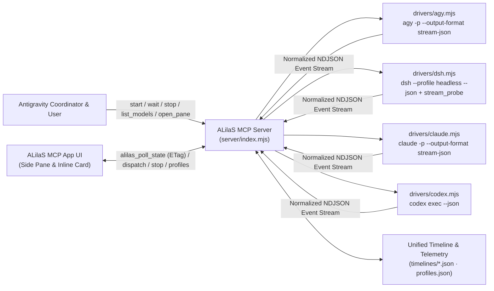

<p align="center">
  
</p>

<p align="center">
  <a href="README.md">English</a> | <b>简体中文</b>
</p>

<p align="center">
  
  
  
  
  
  
</p>

---

**ALilaS**（**A**ntigravity + **LilaS**）是一款面向 **Antigravity** 的原生多引擎子代理工作台（`better-subagent`），基于 **MCP Apps（SEP-1865）** 规范构建。

它将 **Antigravity 原生（`agy`）**、**DeepSeek Harness（`dsh`）**、**Claude Code（`claude`）** 与 **OpenAI Codex CLI（`codex`）** 四大无头智能体引擎统一收敛于一套工作区隔离的原生侧边栏与内联卡片架构中，提供 **进程级并发模型路由**、**Token 级实时流式推理可视化**、**结构化工具调用链路追踪**、**原生精度上下文与吞吐遥测** 以及 **静默异常自动检测与容错恢复**。

<p align="center">
  
</p>

---

## 核心能力

### 1. 统一多引擎调度层（`AGY` · `DSH` · `Claude` · `Codex`）
- **Antigravity Native (`agy`)**：动态探测全量原生模型（Gemini 4 Neon / Carbon / Argon / Hydrogen、Orchestrator、Claude Opus / Sonnet 5.5、GPT-OSS 120B），按基名自动归类并折叠 **Thinking Effort** 推理档位，无需额外配置外部 API Key。
- **DeepSeek Harness (`dsh`)**：采用官方 Mode A 无头执行与零侵入本地 Cordis 探针（`stream_probe.mjs`），支持 1M 上下文窗口；内置只读配置解析器，可自动发现 `~/.dsh/profiles/desktop/cordis.patch.yml` 中的多渠道上游与模型。
- **Claude Code (`claude`) & Codex CLI (`codex`)**：原生对接 `stream-json` 与 `exec --json` 协议，自动检测 CLI 环境，无缝兼容官方登录态、`~/.codex/config.toml`、`~/.claude/settings.json` 及 **CCSwitch** 等第三方中转配置。

### 2. 进程级并发隔离与动态模型路由
- 支持在 **模型与设置** 视图中一键指定全局默认模型，同时允许任意并发会话独立覆盖目标引擎、模型与推理强度（`Thinking Effort`）。
- `agy` / `claude` / `codex` 通过进程级 CLI 参数实现完全隔离；`dsh` 按单次运行动态生成独立临时 `--patch` 覆写层并在进程退出时自动回收，绝不修改共享配置文件，保障多会话并发调度零冲突。
- **零明文凭据持久化**：自定义上游预设仅保存 API Key 对应的环境变量名，绝不落盘或输出任何明文密钥。

<p align="center">
  
</p>

### 3. 三视图隔离的原生精度遥测体系
顶部极简遥测条（`⚙  ◐ 31%  ★ 113.3 tok/s  ılı 136.9M`）将**当前会话上下文**、**跨会话累计用量**与**模型设置**严格拆分为三个独立视图，互不干扰：
- **当前会话上下文视图**：实时呈现上下文窗口占用与预警状态（70% / 85% 分级着色）、纯流式生成速率（`tok/s`）、步级耗时、首字延迟（TTFT）、Prompt Cache 命中率及历史与实时步骤明细。
- **累计 Token 用量视图**：全量基于原生 Usage 字段精确聚合历史与实时会话（零估算失真），提供未缓存输入 / 缓存读取 / 生成输出构成条、近 16 周活跃热力图以及按引擎/模型的消耗排行。

<p align="center">
  
</p>

### 4. 结构化工具链路与无界长任务容错
- **调用配对与文件直达**：按 `toolCallId` 自动将工具入参与执行结果合并为单张折叠卡片，标注精确耗时（`ms` / `s`）与异常状态；点击文件路径胶囊可通过 Antigravity 原生 `toggle-aux-pane` 在侧边栏直接打开文件预览。
- **双权限执行模式**：底部一键切换 **自动执行** 与 **只读审计**（`agy --mode plan` / `claude --permission-mode plan` / `codex --sandbox read-only`），兼顾重度编码实现与安全代码审查。
- **无界长任务与异常自动检测**：默认取消总时长硬性超时（`timeout_sec = 0`），避免长耗时编译或测试被中途中断；内置可配置阈值的静默状态自动检测（默认 `180s`），配合 `90s` 分段心跳轮询（`alilas_wait_task`）、整棵进程树终止（`alilas_stop_task`）与上游风控截断识别，实现高可靠自动恢复。
- **工作区严格隔离与双端同步**：会话列表与多并发子代理切换栏自动按当前工作区 `cwd` 隔离；单文件零外链 UI 严格遵循 MCP App CSP 规范，原生适配 Antigravity 亮/暗主题。

---

## 系统架构



---

## 快速安装

### 环境要求
- **Antigravity**（已启用 MCP Apps 与全局插件支持）
- **Node.js `>= 22.15`**（使用内置 `zlib.zstdDecompressSync`）
- 本机安装以下任意一个或多个 CLI：`agy`、`dsh`、`claude`、`codex`

### 一键脚本部署

**Windows（PowerShell）：**
```powershell
git clone https://github.com/AsahiYi/ALilaS.git
cd ALilaS
powershell -ExecutionPolicy Bypass -File .\scripts\install.ps1
```

**macOS / Linux：**
```bash
git clone https://github.com/AsahiYi/ALilaS.git
cd ALilaS
bash ./scripts/install.sh
```

> 安装脚本会自动将插件部署至 `~/.gemini/config/plugins/alilas/`、安装服务端依赖并构建单文件 UI；升级重装时会自动保留本机已有的 `config/mode_a_patch.yml` 与 `mcp_config.json` 自定义环境变量。

### 自定义上游与中转配置
- **界面配置**：点击顶部 `⚙`（或左下角模型胶囊）进入 **模型与设置** 视图，在「自定义上游预设」折叠栏中注册任意 OpenAI 兼容或 Anthropic 中转模型（仅存环境变量名，不存明文 Key）。
- **CCSwitch 用户**：`codex` 与 `claude` 驱动默认继承本机 `~/.codex/config.toml`、`~/.claude/settings.json` 及相关环境变量，开箱即用。
- **DSH 基础补丁**：可复制 `config/mode_a_patch.example.yml` 为 `config/mode_a_patch.yml`（已被 `.gitignore` 忽略）。

---

## MCP 工具清单

| 工具名称 | 可见性 / 入口 | 说明 |
| :--- | :--- | :--- |
| `alilas_open_pane` | Model + App（`aux_pane` + `global`） | 打开或聚焦按 `cwd` / `session_id` 隔离的 **ALilaS** 侧边栏 |
| `alilas_start_task` | Model + App（对话内联卡） | 异步启动任意引擎（`agy` / `dsh` / `claude` / `codex`），支持单次模型、推理强度与权限模式覆盖 |
| `alilas_wait_task` | Model | `90s` 分段心跳等待（支持 `status_only`），返回静默异常告警、上下文/TPS 遥测与最高 32K 最终回复 |
| `alilas_stop_task` | Model | 强杀目标子代理及整棵进程树（Windows 走 `taskkill /T /F`），立即释放同会话并发锁 |
| `alilas_list_models` | Model | 列出已探测的引擎、原生与 DSH 上游模型目录、自定义预设及全局默认项 |
| `alilas_list_sessions` | Model | 列出跨引擎子代理会话，支持按工作区 `cwd` 过滤 |
| `alilas_poll_state` | App-only | 基于 ETag 的轻量级增量状态轮询（项目隔离、实时流与聚合遥测） |
| `alilas_ui_send_task` | App-only | 面板直接派发任务（携带当前选定引擎、模型、推理强度与工作目录） |
| `alilas_ui_stop_task` | App-only | 面板顶部停止按钮触发进程树终止 |
| `alilas_ui_manage_session` | App-only | 内联重命名、置顶与隐藏会话（不修改磁盘原始日志） |
| `alilas_ui_manage_profiles` | App-only | 设置全局默认模型、刷新引擎探测、修改运行设置与管理自定义上游预设 |

---

## 环境变量

| 变量名 | 默认值 | 说明 |
| :--- | :--- | :--- |
| `ALILAS_AGY_BIN` | `PATH` 中的 `agy` | 指定 Antigravity CLI 路径 |
| `ALILAS_DSH_BIN` | `PATH` 中的 `dsh` | 指定 DSH CLI 或 `@deepseek-ai/dsh/lib/bin.js` 路径 |
| `ALILAS_CLAUDE_BIN` | `PATH` 中的 `claude` | 指定 Claude Code CLI 路径 |
| `ALILAS_CODEX_BIN` | `PATH` 中的 `codex` | 指定 Codex CLI 路径 |
| `ALILAS_PATCH_FILE` | `config/mode_a_patch.yml` | 自定义 DSH 基础 YAML 补丁路径 |
| `ALILAS_DSH_SESSIONS_DIR` | `~/.dsh/sessions` | 自定义 DSH 会话日志目录 |
| `ALILAS_DEFAULT_CWD` | `process.cwd()` | 默认兜底工作目录 |

---

## 开源协议

[MIT](LICENSE) © 2026 AsahiYi
