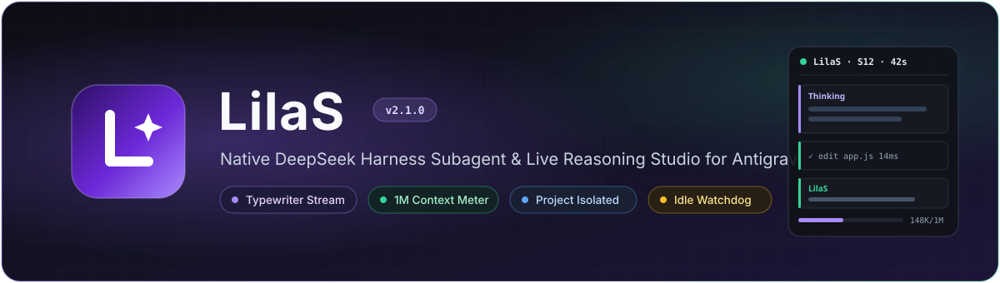
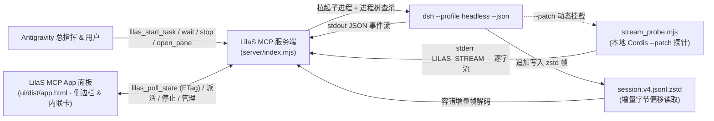

<p align="center">
  
</p>

<p align="center">
  <a href="README.md">English</a> | <b>简体中文</b>
</p>

<p align="center">
  
  
  
  
  
</p>

---

**LilaS** 是一款面向 **Antigravity** 的原生 **MCP App 全局插件**，将本机 **DeepSeek Harness（DSH）** 以官方 **Mode A 无头模式** 桥接为你的专属执行子代理——在 Antigravity 内直接提供 **打字机级实时思维链**、**合并工具调用与耗时卡片**、**1M 上下文用量仪表**、**项目严格隔离** 与 **卡死看门狗自愈**。

> **总指挥 + 执行子代理协作**：让 Antigravity 专注架构设计、方案把关与独立验收，把重型编码、批量脚本、数据审计与回归测试派给 LilaS；全程在侧边栏实时可见思考过程，无需切窗口，也绝不干扰 DSH 桌面端会话。

---

## 核心亮点

- **零侵入打字机级实时流**
  通过 DSH 官方 `--patch` 挂载约 40 行本地 Cordis 探针（`server/stream_probe.mjs`），直接订阅 `agent/assistant-stream` 推送 token 级 `reasoning-delta`、`text-delta`、`tool-call-delta` 与 `usage`，思考第 1 秒就能逐字看到输出；落盘后自动去重切换，零闪烁零重复。
- **工具调用 Call + Result 自动合并 & 点击直达文件**
  按 `toolCallId` 将 `tool/call` 与 `tool/result` 配对合并为单张折叠卡片，直接显示执行状态（`✓` / `✕` / `…`）、智能参数摘要、精确毫秒/秒级耗时与真实报错状态；点击卡片内的文件名胶囊可通过 Antigravity 原生 `toggle-aux-pane` 直接在侧栏打开预览。
- **1M 上下文进度条与 Prompt Cache 命中率**
  实时提取每步 `totalTokens` 与 `cacheReadTokens`，在顶部状态条展示上下文占用进度（>70% 橙色提示、>85% 红色告警，悬停查看缓存命中率），长会话逼近自动压缩线一目了然。
- **按项目严格隔离 + 对话内联卡 & 右侧大窗双视图**
  按工作区 `cwd` 自动隔离会话列表与多开分身胶囊条，多项目并行互不串场（`⋯` 折叠栏可随时切回「全部项目」总览）。派活时既在对话流留下紧凑进度卡，又同步刷新右侧完整大窗。
- **不误杀长任务：无活动卡死看门狗 + 自动自愈**
  默认**不设总时长硬超时**（`timeout_sec = 0`），彻底告别正常干活 15 分钟被误杀；改由 **180 秒无活动看门狗**（监控 stdout/stderr 流与 `.zstd` 增长）捕获真卡死，搭配 **90 秒分段等待**、`lilas_stop_task`（Windows 整棵进程树 `taskkill /T /F` 查杀）与上游风控截断告警，让主代理自主中止并重派。
- **增量字节偏移 Zstd 解码 + ETag 零冗余轮询**
  基于 Node 22 内置 `zlib.zstdDecompressSync` 实现容错帧扫描与按字节偏移增量解码，活跃 `.jsonl.zstd` 每次仅解码新增尾帧；`lilas_poll_state` 内置 ETag 比对，无变化时跳过整包序列化。
- **极简自包含 UI（亮/暗双主题）**
  打包为单个无外链 HTML（严格遵循默认 CSP），内置零依赖 XSS-safe Markdown 渲染与代码块复制、沙箱兼容剪贴板降级、内联会话重命名/置顶/隐藏（绝不改动硬盘 `.zstd`）、增量 DOM 防划词选区丢失，原生跟随 Antigravity 亮暗主题变量。
- **安全与零冲突设计**
  严格走 Mode A 独立会话，前置拦截误传桌面端 `standard` preset 会话 ID，续聊自动继承原会话精确 `cwd`，全程复用 DSH 自身凭据管理，绝不读取、存储或输出任何 API Key 明文。

---

## 架构概览



---

## 环境要求

- **Antigravity**（支持 MCP Apps 与全局插件）
- **Node.js `>= 22.15`**（使用内置 `zlib.zstdDecompressSync`）
- 本机已安装 **DeepSeek Harness（`dsh`）**（在 `PATH` 中可用，或通过 `LILAS_DSH_BIN` 指定路径）

---

## 快速安装

### 一键脚本安装

**Windows（PowerShell）：**
```powershell
git clone https://github.com/AsahiYi/LilaS.git
cd LilaS
powershell -ExecutionPolicy Bypass -File .\scripts\install.ps1
```

**macOS / Linux：**
```bash
git clone https://github.com/AsahiYi/LilaS.git
cd LilaS
bash ./scripts/install.sh
```

脚本会自动将插件安装到 `~/.gemini/config/plugins/lilas/`，安装服务端依赖并构建单文件 `ui/dist/app.html`。

### 配置模型与补丁（可选）

如需挂载自定义 OpenAI 兼容中转、启用 DSH 凭据存储或停用 `tool-result-pruner`：

```bash
cp ~/.gemini/config/plugins/lilas/config/mode_a_patch.example.yml \
   ~/.gemini/config/plugins/lilas/config/mode_a_patch.yml
```

按需编辑 `config/mode_a_patch.yml`（已被 `.gitignore` 忽略，不会误提交）。

若 `dsh` 未加入全局 `PATH`（例如使用 DSH 桌面端内置 CLI），在 `~/.gemini/config/plugins/lilas/mcp_config.json` 中补充 `LILAS_DSH_BIN`：

```json
{
  "mcpServers": {
    "lilas": {
      "command": "node",
      "args": ["${PLUGIN_ROOT}/server/index.mjs"],
      "env": {
        "LILAS_PLUGIN_ROOT": "${PLUGIN_ROOT}",
        "LILAS_DATA_DIR": "${PLUGIN_DATA}",
        "LILAS_DSH_BIN": "D:\\path\\to\\dsh\\resources\\app\\dsh\\node_modules\\@deepseek-ai\\dsh\\lib\\bin.js"
      }
    }
  }
}
```

安装完成后，点击 Antigravity 右侧边栏 **`+`** → **「LilaS」** 或左侧导航栏 **「LilaS」** 即可使用。

---

## MCP 工具一览

### 模型侧工具
| 工具名 | 说明 |
| :--- | :--- |
| `lilas_open_pane` | 打开/聚焦右侧 **LilaS** 侧边栏（`aux_pane` + `global` 入口），自动按 `cwd` / `session_id` 隔离项目 |
| `lilas_start_task` | 异步启动 Mode A 子代理，在对话流展示项目隔离内联状态卡，等待最多 10s 返回 `session_id`（默认不限总时长） |
| `lilas_wait_task` | 分段等待（默认 `90s`，支持 `status_only: true` 瞬时查进度），返回静默时长、`[STALLED]` 卡死告警、风控截断告警与最高 32K 完整回复 |
| `lilas_stop_task` | 强杀卡死或运行中的任务及全部子进程树，释放并发锁以便立即重派 |
| `lilas_list_sessions` | 列出 Mode A 会话（可按 `cwd` 过滤当前项目，显示别名与置顶标记） |

### 面板内部工具（`visibility: ["app"]`）
| 工具名 | 说明 |
| :--- | :--- |
| `lilas_poll_state` | 带 ETag 短路的实时轮询，返回隔离后的会话、活跃分身、逐字流与时间线 |
| `lilas_ui_send_task` | 从面板底部直接发送任务（新建会话支持 `cwd` 选择与历史记忆） |
| `lilas_ui_stop_task` | 面板顶部「停止」按钮强杀子进程树 |
| `lilas_ui_manage_session` | 会话内联重命名、置顶、隐藏（仅写元数据，不碰硬盘 `.zstd`） |

---

## 开源协议

[MIT](LICENSE) © 2026 AsahiYi
