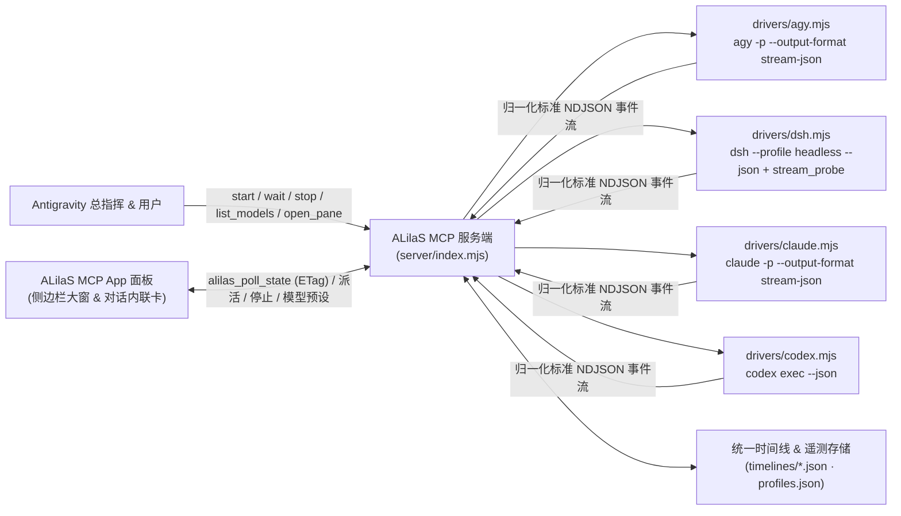

<p align="center">
  
</p>

<p align="center">
  <a href="README.md">English</a> | <b>简体中文</b>
</p>

<p align="center">
  
  
  
  
  
  
</p>

---

**ALilaS**（**A**ntigravity + **LilaS** 紫丁香）是一款面向 **Antigravity** 的原生 **增强子代理工作台（`better-subagent`）**，基于 **MCP Apps（SEP-1865）** 打造。

它将四大无头 CLI 智能体引擎——**Antigravity 原生（`agy`）**、**DeepSeek Harness（`dsh`）**、**Claude Code（`claude`）** 与 **OpenAI Codex CLI（`codex`）**——统一收拢进一个极简、项目隔离的侧边栏与内联卡片中，提供 **多会话零冲突模型切换**、**打字机级实时思维链**、**合并工具耗时卡**、**环形上下文 / TPS / 累计 Token 遥测** 与 **卡死看门狗自愈**。

---

## 核心特性

- **一窗驾驭四大引擎（`AGY` · `DSH` · `Claude` · `Codex`）**
  - **Antigravity 原生（`agy`）**：通过 `agy models` 自动拉取全量原生模型（Gemini 4 Neon/Carbon/Argon/Hydrogen、Gemini 3.8 Flash、Claude Opus/Sonnet 5.5、GPT-OSS 120B），**免额外 API Key**、直用 Antigravity 额度。
  - **DeepSeek Harness（`dsh`）**：官方 Mode A 无头驱动 + 零侵入本地 Cordis 探针（`stream_probe.mjs`），支持 1M 上下文与任意 OpenAI 兼容自定义上游模型。
  - **Claude Code（`claude`）& Codex CLI（`codex`）**：内置标准 `stream-json` / `exec --json` 协议适配，自动检测安装状态，**原生零配置兼容 ccswitch 及中转站环境变量**。
- **精简底部模型胶囊 + 两级级联选择弹窗**
  去除冗余顶部下拉条，底部仅留一枚精简模型胶囊（`✦ DeepSeek-V4.1-Flash · 高 ▾`）。点击弹出的紧凑菜单支持关键词搜索、引擎分页、原生模型按基名合并折叠 **Thinking Effort** 强度芯片与 `★ 设为默认`，以及 **DSH 上游按渠道手风琴折叠**（自动只读扫描本机 `~/.dsh/profiles/desktop/cordis.patch.yml` 全部上游与模型，绝不碰明文 Key）。
- **自由选模型，多会话并发零冲突**
  可在面板一键设置全局「默认子代理模型」，也能在任意新会话随时切到其他引擎、DSH 任意上游或自定义预设；`agy`/`claude`/`codex` 走进程级 CLI 参数隔离，`dsh` 按单次运行生成独立临时 `--patch`（退出即删），绝不覆写共享配置，十个并发子代理用十个不同模型也互不打架。
- **极简遥测条 + 可点击三标签抽屉（`⚙  ◐ 35%  ★ 115.6 tok/s  ılı 117.0M`）**
  - **SVG 细圆环上下文进度 + 实测 TPS + 累计 Token**：支持实时流测速与历史 DSH 会话步长反推真实 `tok/s`；
  - **点击 `⚙` 或遥测数字展开全屏内嵌抽屉**：「当前会话」（上下文预算条、纯流式速度 / 耗时 / TTFT / 缓存命中 / 最近调用）、「累计用量」（精准 Token 计数、缓存构成条、近 16 周活动热力图、按引擎/模型分布，拒绝拍脑袋估价）、「设置与上游」（引擎探测刷新、卡死阈值、DSH 桌面扫描开关与自定义上游预设）。
- **工具调用 Call + Result 合并 & 点击直达文件**
  按 `toolCallId` 自动配对合并为单张折叠卡，显示精确耗时（`ms`/`s`）、真实报错与智能参数摘要；点击文件名胶囊通过 Antigravity 原生 `toggle-aux-pane` 直接在侧栏预览文件。
- **自动执行 / 只读审计一键切换**
  支持 `自动`（正常读写与跑命令）与 `只读`（`agy --mode plan` / `claude --permission-mode plan` / `codex --sandbox read-only`），代码体检与审查更安心。
- **不误杀长任务：无活动看门狗 + 自动自愈**
  默认不设总时长硬上限（`timeout_sec = 0`），长任务绝不被中途误杀；180 秒无活动看门狗精准抓真卡死，搭配 90 秒分段等待、`alilas_stop_task`（Windows 整棵进程树 `taskkill /T /F` 查杀）与上游风控截断告警。
- **严格项目隔离 + 对话内联卡 & 右侧大窗双视图**
  按工作区 `cwd` 自动隔离会话列表与分身胶囊条（`⋯` 折叠栏随时切换「全部项目」），对话流留紧凑状态卡、右侧大窗同步完整时间线。
- **极简自包含 UI（亮/暗双主题）**
  单文件 HTML 无任何外链请求，内置零依赖 XSS-safe Markdown 渲染与代码块复制、沙箱兼容剪贴板降级、内联会话重命名/置顶/隐藏、增量 DOM 不丢划词选区。

---

## 架构概览



---

## 快速安装

### 环境要求
- **Antigravity**（支持 MCP Apps 与全局插件）
- **Node.js `>= 22.15`**
- 本机安装以下任意一个或多个 CLI：`agy`、`dsh`、`claude`、`codex`

### 一键脚本安装

**Windows（PowerShell）：**
```powershell
git clone https://github.com/AsahiYi/ALilaS.git
cd ALilaS
powershell -ExecutionPolicy Bypass -File .\scripts\install.ps1
```

**macOS / Linux：**
```bash
git clone https://github.com/AsahiYi/ALilaS.git
cd ALilaS
bash ./scripts/install.sh
```

### 自定义上游模型与中转站（支持 CCSwitch）
- **面板内直配**：点输入框上方的 **`+ 上游`** 可随时添加自定义上游模型预设（仅保存环境变量名，**绝不保存 API Key 明文**），点 **`默认`** 设为全局默认子代理模型。
- **CCSwitch 用户**：`codex` 和 `claude` 驱动默认继承你的 `~/.codex/config.toml`、`~/.claude/settings.json` 与环境变量，无需重复配置。
- **DSH 基础补丁**：可复制 `config/mode_a_patch.example.yml` 为 `config/mode_a_patch.yml`（已被 `.gitignore` 忽略）。

---

## 开源协议

[MIT](LICENSE) © 2026 AsahiYi
